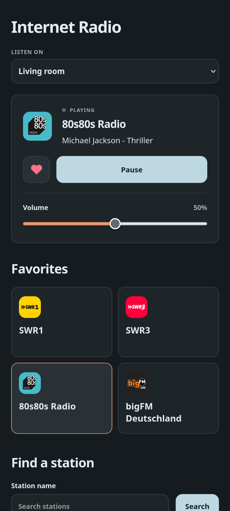
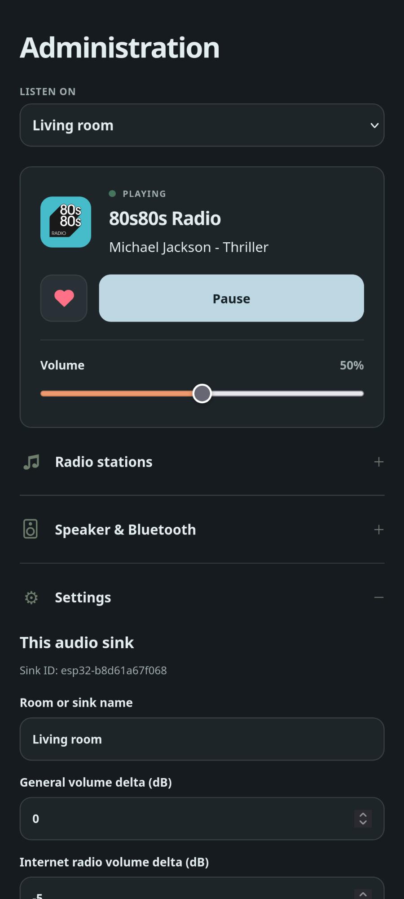
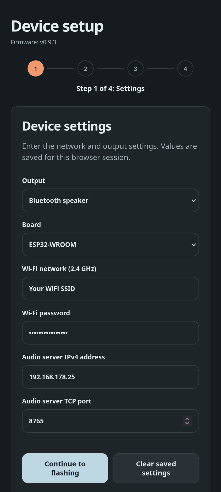

# ESP32 Wi-Fi audio sink

<p align="center">
  
  
  
</p>

Turn an original ESP32 into a network audio receiver for a Bluetooth speaker or
PCM5102/PCM5102A I2S DAC. A Linux server receives Internet radio, Spotify Connect,
classic AirPlay or WFAS audio and streams it over Wi-Fi to the ESP32.

One server can manage multiple sinks with independent sources, names, volume and
saved settings. The built-in website provides a listening page and an admin page
for Bluetooth configuration, stations and diagnostics. A separate `/setup` page
flashes and approves new devices. Home
Assistant can embed the website through an external ingress proxy.

## Install the server with Docker

Use a Linux **x86_64 / amd64** host with Docker Engine and Docker Compose.
The image includes Python, FFmpeg, Spotify and the patched AirPlay receiver;
no ESP-IDF build is needed for the server or the bundled firmware.

From the repository root:

```sh
docker compose up -d --build
```

The first build downloads and compiles the receiver dependencies. Open
`http://<SERVER-IP>:8080/` for listening, `/admin` for administration and `/setup`
for flashing and approving devices. The ESP32 connects to the host's LAN IPv4
address on TCP **8765**. The container uses **host networking** for Spotify,
AirPlay and WFAS discovery; it does not use port mappings.

Settings, approved devices, favorites and receiver credentials persist in the
`radio-data` Docker volume mounted at `/data`. Keep that volume when updating.
The application runs as UID/GID 10001 by default. It serves HTTP by default; use your own reverse proxy or enable the
[optional self-signed setup HTTPS listener](docker/README.md#optional-https-for-browser-flashing).
Keep the service on a trusted LAN.

### Updates and management

After pulling a new release:

```sh
git pull --ff-only
docker compose up -d --build
docker compose logs -f radio
```

This replaces the container while retaining its data volume. Firmware updates
remain separate. To stop the server, use `docker compose down`; do not add `-v`
unless you intend to delete all saved data.

### Published Docker image

[compose.example.yaml](compose.example.yaml) runs the published
`ghcr.io/skyslycer/esp32-wifi-sink:latest` image with persistent storage:

```sh
docker compose -f compose.example.yaml up -d
```

## Install firmware on the ESP32

### Browser setup

Open `http://<SERVER-IP>:8080/setup` for the separate setup wizard:

1. Select the board and output, then enter Wi-Fi credentials, the server LAN
   IPv4 address and TCP port. The selected board’s firmware version appears next
   to the page title. I2S output also lets you choose the GPIOs.
2. Plug the selected board into the computer running your browser and select
   **Connect & flash**. Select a flash baud rate on this screen (460800 by default).
   The server supplies the board’s published firmware image. Wi-Fi
   settings are written directly by the browser to a separate configuration
   partition; credentials are not submitted to the server or compiled into images.
3. Wait for the device to join Wi-Fi, then enter its room or sink name and approve it.
4. Choose **Set up another device** or open Administration to select a speaker
   and source.

Setup values, including the Wi-Fi password, are remembered in `sessionStorage`
for this tab's session. **Clear saved settings** removes them. The next-device
button keeps board, network and output settings. Naming happens separately during approval.

Browser USB access needs a secure origin. Use an HTTPS reverse proxy, access
through `localhost` on the browser computer, or enable the container's optional
self-signed HTTPS listener:

```dotenv
SINK_SETUP_HTTPS_ENABLED=true
SINK_SETUP_HTTPS_HOSTS=192.168.1.20
```

Replace the IP with your server's LAN address. After recreating the container,
trust its generated public certificate on the flashing computer and open
`https://<SERVER-IP>:8443/setup`. See [certificate setup and port options](docker/README.md#optional-https-for-browser-flashing).
This option defaults to `false`; ordinary HTTP stays available when enabled.
Use desktop Chrome or Edge with Web Serial support. An HTTP LAN address can
review and approve pending clients, but USB flashing is disabled there.

New clients remain pending and cannot play until approved in `/setup`.
Spotify, AirPlay and Wi-Fi streaming are enabled by default for approved sinks.
Spotify/AirPlay receivers start automatically when installed on the server.
Disable or re-enable each mode under Admin → Settings → Input modes, then save.
The Internet radio checkbox is enabled by default and controls visibility of
Favorites and station search for that sink; it does not stop current playback.
WFAS still requires choosing a sender and pressing Connect; enabling its input
mode alone does not select a sender. Receiver preferences survive restarts and
unpairing; unpairing stops the receivers until the sink is approved again. `/admin` has **Unpair this
sink**, which stops playback and receivers and returns the device to pending
approval. Approval and naming are available only through the setup workflow;
there is no admission checkbox in the normal settings panel. Setup endpoints use
the same trusted-LAN access boundary as the rest of the application.

If an already-approved board is reflashed in the wizard, it is unpaired after the
write and must be approved again. Flashing replaces the firmware and Bluetooth NVS
settings. Server-side names/preferences remain until you rename or change them.

### Command-line setup (Linux, macOS and Windows)

The interactive Python flasher uses the same bundled images as `/setup`; it does
not need ESP-IDF or a firmware build. Install **Python 3.10 or later** and keep
the complete repository together.

Linux / macOS:

```sh
python3 -m venv .flash-venv
.flash-venv/bin/python -m pip install -r tools/cli-flasher/requirements.txt
.flash-venv/bin/python tools/cli-flasher/flash.py
```

Windows (PowerShell):

```powershell
py -3 -m venv .flash-venv
.\.flash-venv\Scripts\python.exe -m pip install -r tools/cli-flasher/requirements.txt
.\.flash-venv\Scripts\python.exe tools/cli-flasher/flash.py
```

Select a board from the catalog, then choose its output and enter Wi-Fi/server
settings and any I2S GPIOs. The CLI shows the shared firmware version before board selection. Select the USB
serial port; the flash baud rate defaults to 460800 and can be set with `--baud`. Close any serial
monitor or browser connection using the port first. The password prompt is hidden.
The script verifies the firmware hash, writes firmware and configuration, verifies
the flash through esptool, and resets the board.

It then offers approval and naming through the same server API as `/setup`.
The script first tries `http://<server>:<TCP-port>/setup` without prompting. If
that address does not serve the setup API, it asks for the actual setup URL.
The audio TCP port defaults to **8765**; the website normally uses **8080**, so
these ports can differ. Your actual URL can include an HTTPS proxy and path prefix.
Enter `skip` at the URL prompt to finish setup later.

After flashing, you can continue approval on the webpage and close the program
with **Ctrl+C**; the completed flash is unaffected. A previously approved board
is returned to pending approval when the server is reachable. The script can flash
another board with the same settings without asking for Wi-Fi details again.
Settings stay in memory, and the private temporary configuration file is removed
after flashing.

Board, output type, Wi-Fi, server address, TCP port, I2S pins and serial port are all
interactive prompts. The serial prompt lists available ports. The only options
apart from `--help` are:

```sh
python tools/cli-flasher/flash.py --baud 460800
python tools/cli-flasher/flash.py --flash-only
python tools/cli-flasher/flash.py --configure-only
python tools/cli-flasher/flash.py --list-ports
```

Use your virtual environment's Python command above in place of `python`.
`--flash-only` skips CLI approval/name prompts; use `/setup` afterward.
`--configure-only` writes only the setup partition, preserving installed firmware,
Bluetooth pairing and existing server approval. It also offers naming and approval
for new devices; you can do that on `/setup` instead and close the program with
Ctrl+C after the settings write. Use it to change network settings or
provision a custom build. Choose the matching board and the output type already
installed on it.
It supports `--baud` and can configure multiple boards with the same settings;
it cannot be combined with `--flash-only`.

For manual IDF builds, see [Build and flash manually](firmware/README.md#build-and-flash-manually).

## Supported input modes and requirements

All modes use the same server-to-ESP32 audio connection. Bluetooth and I2S are
output choices fixed at firmware build time.

| Input | Requirements and setup |
| --- | --- |
| Internet radio | Available by default. Choose a station or save a stream URL in the website. The server needs access to the stream and FFmpeg to decode it. |
| Spotify Connect | Included in the Docker image and enabled by default for each approved sink. Uses pinned go-librespot 0.10.7 for **Linux x86_64**. Use the Spotify client to connect and authenticate. |
| Classic AirPlay | Included in the Docker image and enabled by default for each approved sink. The image includes patched Shairport Sync and Avahi for discovery. The sender and server need LAN discovery connectivity. This is classic AirPlay audio; AirPlay 2 is not implemented. |
| [WFAS v2 unicast](https://github.com/marcomorosi06/WiFiAudioStreaming-Desktop) (experimental) | Available by default. Run a compatible WFAS sender, choose **Send (Server)** and connect from the listening page. Configure **44,100 or 48,000 Hz, signed 16-bit stereo, security Off**. |

Spotify's adaptive tempo path uses Rubber Band 3 or later, included in the Docker image.
AirPlay presentation timing uses the project's patched receiver and output-delay
feedback. Use the firmware shipped with the server release: adaptive buffering
and output timing are required for every sink. Speaker latency still requires a
useful delay report or output calibration; video synchronization is not guaranteed.

WFAS discovery uses multicast beacons at **239.255.0.1:9091**. Keep sender and
server on a LAN with multicast allowed, or connect using the sender's address.
A unicast sender accepts one receiver at a time. The selected sample rate must
match the sender; 48 kHz is resampled to 44.1 kHz. Multicast audio, encrypted WFAS
and other sample formats are not implemented. WFAS has no presentation clock or
A/V synchronization. Its source trim in Admin is separate from the main volume.

Home Assistant ingress embeds the player; it is not an audio input. Point your
external ingress proxy at HTTP 8080, use a trailing slash on the player URL and
allow SSE streaming without buffering. ESP32 traffic connects directly over the
LAN on TCP 8765. No native Home Assistant integration or Google Cast receiver is
shipped.

## Technical overview

The Python/FastAPI server supervises independent device sessions and optional
receiver processes. Sources feed a PCM processing pipeline with gain, resampling
and buffering before FFmpeg encodes SBC. Volume and trim changes ramp over
150 ms in PCM; Bluetooth hardware volume uses bounded stepped updates. A framed TCP connection carries device
control, SBC audio and playback feedback.

For Bluetooth output, the ESP32 forwards SBC to an A2DP speaker. For I2S output,
it decodes SBC locally and sends PCM to the DAC. The patched ESP-IDF limits
Bluetooth queues and network allocations to fit the original ESP32's memory.
TCP SACK is required.

Buffering policies differ by source: radio uses fixed Group 0, Spotify uses
conservative Group 1, and AirPlay/WFAS use interactive Group 2. Timed AirPlay
preserves presentation anchors and uses output-delay feedback. WFAS uses bounded
queues and short-loss concealment with adaptive backlog handling.

The frontend uses relative paths for ingress compatibility and SSE for live
updates. Device preferences persist on disk; new devices wait for approval in `/setup`. The container runs the application as an unprivileged user, with a read-only
application filesystem and a persistent writable `/data` directory.

See [firmware build and publishing instructions](firmware/README.md) for manual
builds, board metadata and publishing the web flasher's firmware catalog.

Server releases use the root [VERSION](VERSION) file. The API, startup log and
all page footers read that value; update it when releasing server changes and
rebuild the Docker image. All boards share the separate [firmware/VERSION](firmware/VERSION) file,
which is published in the firmware catalog. Updating one does
not change the other.
